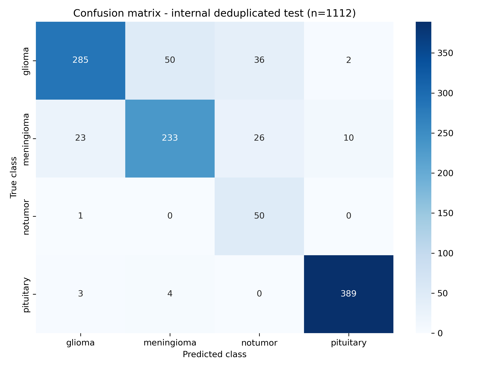
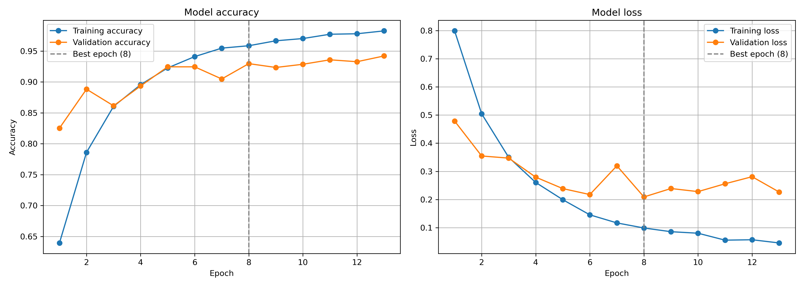
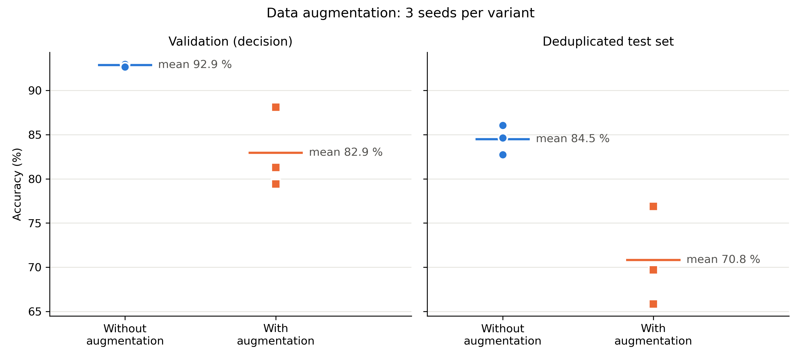
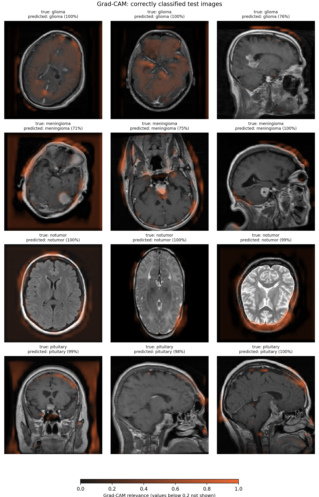
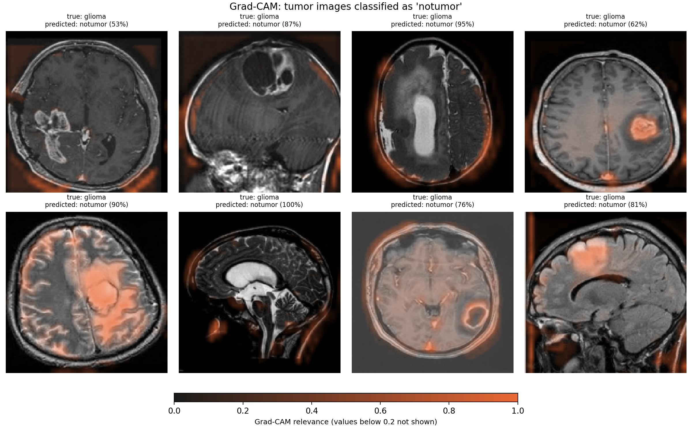

# CerebroCAM

**Brain tumor MRI classification with a compact CNN, duplicate-aware evaluation and Grad-CAM**

[](https://github.com/HeikoHan72/cerebro-cam/actions/workflows/ci.yml)


[](LICENSE)

> **Medical disclaimer.** This is an educational machine learning project. It is not a medical
> device, has not been clinically validated and must not be used for diagnosis or treatment decisions.

CerebroCAM classifies single 2D brain MRI slices into four classes: **glioma**, **meningioma**,
**pituitary tumor** and **no tumor**. I built the first version during the deep learning project week of
my AI Engineer training (August 2026). This repository is a reworked version. It starts from that
original state (first commit) and adds the following, each as its own commit:

- a reproducible pipeline
- an audit of duplicate images in the public datasets
- a re-evaluation of both models on cleaned test sets
- a controlled data augmentation experiment
- Grad-CAM explanations

**Main finding:** the headline numbers are inflated by duplicates. 2,405 of the 3,264 images in the
"external" test set are (near-)identical to training images. On external images the model has not seen,
accuracy drops from 88.8 % to 69.5 %. Grad-CAM also suggests that the model partly relies on features
outside the brain.

## Contents

- [Results](#results)
- [Method](#method)
- [Improvements over the original](#improvements-over-the-original)
- [Limitations](#limitations)
- [Quick start](#quick-start)
- [Step-by-step scripts](#step-by-step-scripts)
- [Project layout](#project-layout)
- [Data and citation](#data-and-citation)
- [License](#license)

## Results

All numbers come from `results/` and are recomputed by the test suite (`tests/test_results.py`).
I compare the model from the project week ("original") with the model retrained in this repository on
the deduplicated training set (seed 42).

| Evaluation set | Images | Original model | Retrained model |
|---|---:|---:|---:|
| Internal test, official split | 1,600 | 88.6 % | 88.0 % |
| **Internal test, deduplicated** (no near-duplicate in training) | **1,112** | **86.1 %** | **86.1 %** |
| External (SARTAJ), all images | 3,264 | 90.6 % | 88.8 % |
| **External (SARTAJ), not in training** | **806** | **71.3 %** | **69.5 %** |

How to read the table:

- **The retrained model is not better than the original.** On the deduplicated test set both reach
  86.1 %. Across three training seeds the retrained setup reaches **84.5 ± 1.7 %** (mean ± standard
  deviation). The differences between the two models are within this seed-to-seed spread. The rework
  improves how trustworthy the numbers are, not the model itself.
- **Duplicates inflate the official split by about 2 points** (88.0 % vs. 86.1 %).
- **The "external" test set is not independent.** The training dataset partly consists of the SARTAJ
  dataset (see [Data](#data-and-citation)). On the 806 SARTAJ images that do not appear in the training
  data, accuracy falls by about 19 points. 652 of these 806 images are gliomas, the hardest class.

### Per-class results (retrained model, deduplicated test set)

| Class | Precision | Recall | F1 | Images |
|---|---:|---:|---:|---:|
| glioma | 0.913 | 0.764 | 0.832 | 373 |
| meningioma | 0.812 | 0.798 | 0.805 | 292 |
| notumor | 0.446 | 0.980 | 0.613 | 51 |
| pituitary | 0.970 | 0.982 | 0.976 | 396 |
| macro average | 0.785 | 0.881 | 0.807 | 1,112 |

The clinically most relevant error is a missed tumor. **62 of 1,061 tumor images (5.8 %) are classified
as "no tumor"** (36 gliomas, 26 meningiomas). Only 51 no-tumor images remain after deduplication.
These 62 false alarms therefore outnumber the 50 correct no-tumor predictions, which is why the
no-tumor precision is only 0.45.

<p align="center">
  
  
</p>

Training stopped after 13 epochs. The best validation loss was reached in epoch 8 (validation accuracy
93.0 %). The gap between validation accuracy (93.0 %) and test accuracy (86.1 %) is discussed under
[Limitations](#limitations).

### Data augmentation experiment

I trained the model three times without and three times with augmentation (horizontal flip, rotation
±10°, translation 10 %, zoom 10 %; seeds 42, 43, 44). The decision rule was fixed in advance: adopt
augmentation only if its mean validation accuracy is higher by more than the larger of the two standard
deviations. The decision uses validation data on purpose, so the test set does not influence the model.

| Metric (mean ± SD, 3 seeds) | Without augmentation | With augmentation |
|---|---:|---:|
| Validation accuracy (decision) | 92.9 ± 0.2 % | 82.9 ± 4.6 % |
| Deduplicated test accuracy (reported only) | 84.5 ± 1.7 % | 70.8 ± 5.6 % |

**Result: augmentation was not adopted.** With this configuration, training with augmentation was
unstable: early stopping selected epochs 4, 3 and 17. This result applies to this setup only (patience 5,
these augmentation strengths). It does not show that augmentation is generally useless here.

<p align="center">
  
</p>

### Grad-CAM

Grad-CAM shows which image regions increase the score of a class. It uses the last convolutional layer
(`conv3`, 37×37 feature map) and the logit before the softmax. The examples are not hand-picked: they
are the first images by file name.

<p align="center">
  
</p>

Observations:

- For some tumors the relevance lies on the lesion (for example the second meningioma). For the
  gliomas it is spread over the whole brain.
- For **no tumor** and **pituitary** images, the relevance often lies **outside the brain**: on the
  skull, the image border or the background.
- In several missed gliomas, the lesion itself increases the "no tumor" score (see figure below).

A plausible explanation is **shortcut learning**. According to the dataset description, all no-tumor
images come from a single source (Br35H). If the sources differ systematically, for example in contrast,
image borders or MRI sequence, the model can learn these differences instead of anatomy. Grad-CAM on 20
images cannot prove this. It is a hypothesis for further work.

<p align="center">
  
</p>

## Method

### Data

| Role | Dataset | Images | License |
|---|---|---:|---|
| Training and internal test | [Brain Tumor MRI Dataset](https://www.kaggle.com/datasets/masoudnickparvar/brain-tumor-mri-dataset) (Nickparvar) | 5,600 + 1,600 | CC BY 4.0 |
| External test | [Brain Tumor Classification (MRI)](https://www.kaggle.com/datasets/sartajbhuvaji/brain-tumor-classification-mri) (SARTAJ) | 3,264 | MIT |

According to its description, the Nickparvar dataset combines figshare (Cheng et al.), SARTAJ (without
its glioma images) and Br35H (all no-tumor images). Sources, licenses and checksums are listed in
[DATA.md](DATA.md). The datasets are not redistributed in this repository.

### Duplicate audit

According to its description, version 2 of the Nickparvar dataset removed duplicates and eliminated the
overlap between training and test. I checked this with perceptual hashing:

- Each image gets two 64-bit fingerprints (pHash and dHash, computed on the grayscale image).
- The distance between two images is the larger of the two Hamming distances.
- **Distance ≤ 2: duplicate.** Such images look identical, even if the file differs (format, size,
  color mode).
- **Distance 3–8: gray zone.** Inspected samples were mostly adjacent slices of the same scan. These
  images are kept and counted as a limitation.
- Duplicate groups are formed transitively (union-find).

| | Original | Removed | Used |
|---|---:|---:|---:|
| Training | 5,600 | 764 duplicates within the training set (no tumor: 1,400 → 729) | 4,836 |
| Internal test | 1,600 | 439 duplicates of a training image + 49 within the test set (no tumor: 400 → 51) | 1,112 |
| External (SARTAJ) | 3,264 | 2,405 duplicates of a training image (2,257 byte-identical) | 806 unique images not in training |

The official split stays unchanged, so results remain comparable with other work. The full assignment of
every image is committed in `results/duplicates/`.

### Model and training

- **Input:** RGB, resized to 150×150 with the Lanczos filter and stored as JPEG (quality 95).
  Training, internal test and external images use the same preprocessing function and the same loader.
- **Architecture:** three convolution blocks (32, 64 and 128 filters, 3×3, ReLU, max pooling), then
  Dense(128), Dropout(0.5) and a softmax output. In total 5,402,308 parameters. This is unchanged from
  the original, so the comparison is fair.
- **Training:**
  - Adam optimizer, categorical cross-entropy loss.
  - Fixed 80/20 split into training and validation.
  - Class weights N / (K · N_c) to balance the deduplicated training set (no tumor: 1.66, other
    classes about 0.87 to 0.90).
  - Early stopping (patience 5) and model checkpoint, **both on validation loss**.
  - At most 40 epochs.
- **Reproducibility:** a global seed and `tf.config.experimental.enable_op_determinism()`. Repeated runs
  on the same machine give identical results.

## Improvements over the original

The first commit contains the project week code unchanged. The following changes were made afterwards:

| Area | Original | Now |
|---|---|---|
| Model selection | Early stopping restored the weights of epoch 9 (best `val_loss`). The checkpoint, however, saved epoch 11 (best `val_accuracy`). The model file that was evaluated was therefore not the model early stopping had selected. | Both callbacks monitor `val_loss` |
| Reproducibility | No global seed, unseeded shuffling | Fixed seeds and deterministic operations |
| Data setup | Data copied by hand, one hard-coded absolute path | `00_setup_data.py` identifies the Kaggle archives, checks the SHA256 checksum and the image counts |
| Duplicates | Not checked | Audit with perceptual hashing, deduplicated training and test sets, external overlap measured |
| Evaluation | Plots and console output only, one test set each | Four evaluation sets, metrics stored as JSON/CSV, the original model evaluated the same way (`10_evaluate_original_model.py`) |
| External pipeline | External images saved with Pillow's default JPEG quality (75) instead of 95, predicted one image at a time | Same preprocessing function and loader as for training, blinded file names |
| Error handling | Errors were caught, printed and skipped | Unexpected files or counts stop the pipeline |
| Class balance | Not needed (balanced data) | Class weights, because deduplication unbalances the training set |
| Experiments | None | Augmentation with and without, 3 seeds each, rule fixed in advance |
| Explainability | Not available | Grad-CAM |
| Code quality | 7 standalone scripts | Package `cerebrocam`, central `config.py`, 51 tests, ruff, GitHub Actions |

## Limitations

- **Patient overlap is still possible.** The datasets contain slices, not patients, and no patient IDs.
  The figshare part alone has 3,064 images from 233 patients. Even after deduplication, 569 of the
  1,112 test images are in the gray zone (distance 3–8 to a training image). These are often
  neighboring slices of the same scan. **The 86.1 % is therefore probably still optimistic.** A
  patient-level split is not possible with these data.
- **The validation set is optimistic as well.** It is a random 20 % of the training images, so adjacent
  slices end up on both sides. Validation accuracy (93.0 %) is clearly higher than test accuracy
  (86.1 %). Decisions made on validation data, such as the augmentation decision, carry this bias.
- **The no-tumor class is small and comes from a single source.** Only 51 no-tumor images remain in the
  deduplicated test set, so the no-tumor metrics are uncertain. All of them come from Br35H, which
  makes shortcut learning possible (see Grad-CAM).
- **The external test is not independent.** SARTAJ is part of the training data. Only the
  "not in training" subset (806 images) is meaningful, and 652 of these images are gliomas. The
  Nickparvar description states that the SARTAJ glioma labels were inconsistent. This is why it replaced
  them with figshare images. External glioma results may therefore partly reflect label noise.
- **The rework covers one model only.** There was no hyperparameter search and no transfer learning.
  The comparison between the original and the retrained model is within the seed spread (±1.7 points).
- **Reproducibility across machines is limited.** Results are bit-identical on the same machine. On
  other machines small deviations are possible (JPEG decoding of the installed Pillow build, CPU
  instructions). In the duplicate audit, 3 distance values differed between two machines, but all
  decisions were identical.
- **Grad-CAM is qualitative.** The heat map is coarse (37×37), and the conclusions are based on 20
  example images.

## Quick start

Requirements: Python 3.11 to 3.13 (tested in CI). A GPU is not needed: training takes about 7 minutes
on a laptop CPU.

```bash
git clone https://github.com/HeikoHan72/cerebro-cam.git
cd cerebro-cam
python -m venv .venv && source .venv/bin/activate
pip install -r requirements.txt
pip install -e .
```

Download both datasets from Kaggle (free account required) and place the two `archive.zip` files in
`data/raw/`. The file names do not matter, because the setup script identifies the archives by their
content:

- <https://www.kaggle.com/datasets/masoudnickparvar/brain-tumor-mri-dataset>
- <https://www.kaggle.com/datasets/sartajbhuvaji/brain-tumor-classification-mri>

Then run the pipeline:

```bash
export MPLBACKEND=Agg                         # save figures without opening windows
python scripts/00_setup_data.py               # check checksums, unpack, count images
python scripts/02_check_duplicates.py         # duplicate audit (about 1-2 minutes)
python scripts/03_preprocessing.py            # resize to 150x150
python scripts/04_training.py                 # train the CNN (about 7 minutes on a CPU)
python scripts/05_evaluate_internal.py        # internal test: official and deduplicated
python scripts/06_prepare_external_data.py    # blinded external images
python scripts/07_run_inference.py
python scripts/08_evaluate_external.py
python scripts/09_gradcam.py
```

Optional:

- `01_eda.py` creates the exploratory analysis.
- `10_evaluate_original_model.py` evaluates the project-week model. It needs `original_model.keras`
  in `models/`.
- `11_augmentation_experiment.py` repeats the augmentation experiment (about 1 to 1.5 hours on a CPU).

Both trained models (`cerebrocam_best_model.keras` and `original_model.keras`) are attached to the
[latest release](https://github.com/HeikoHan72/cerebro-cam/releases/latest). To evaluate the
published model without retraining, put it in `models/` and skip script 04.

Tests and linting:

```bash
pip install -e ".[dev]"
ruff check . && ruff format --check .
pytest
```

The tests use synthetic images and the committed results. Tests that need the Kaggle data are skipped
if the data is missing, as in CI.

## Step-by-step scripts

The scripts in `scripts/` are numbered in pipeline order and divided into `# %%` cells. In Spyder or VS
Code they can be run cell by cell. Comments and console output are in German (the project language of
my training), while code, file names and figures are in English. The logic itself lives in the package
`cerebrocam/`, so the scripts stay short and the tests cover the same code.

## Project layout

```
cerebro-cam/
├── cerebrocam/            package: config, data, duplicates, preprocessing, model,
│                          training, inference, evaluation, gradcam
├── scripts/               00-11, pipeline in numbered steps (Spyder cells)
├── tests/                 pytest suite (51 tests)
├── results/
│   ├── figures/           all figures used in this README
│   ├── duplicates/        image-by-image result of the duplicate audit
│   ├── experiments/       augmentation experiment (runs and summary)
│   ├── original/          outputs of the project week (unchanged) and metrics of the original model
│   └── *.json, *.csv      metrics, predictions, training history
├── data/                  datasets (not in git, created by 00_setup_data.py)
├── models/                trained models (not in git, see release)
├── DATA.md                data sources, licenses, checksums
├── CITATION.cff
├── pyproject.toml
└── requirements.txt       pinned versions used for the published results
```

## Data and citation

Sources, licenses, checksums and the references to cite are listed in [DATA.md](DATA.md). If you use
this code, please cite it via [CITATION.cff](CITATION.cff) (GitHub: "Cite this repository").

## License

The code is licensed under the [MIT License](LICENSE). The datasets are not part of this repository and
keep their own licenses (see [DATA.md](DATA.md)). This also applies to the MRI example images shown in
the figures.
